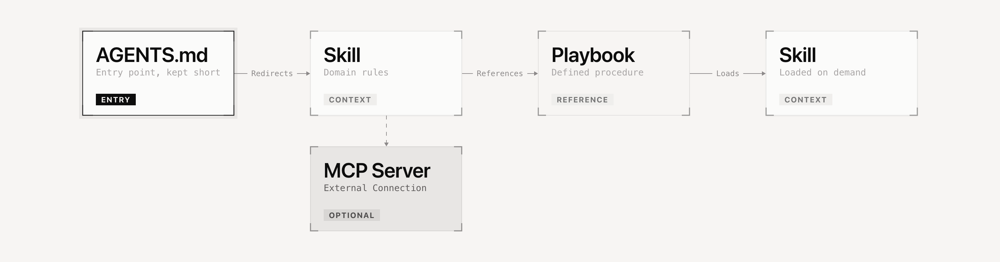

The agent stack, or profile, is a curated selection of what an agent works with: the skills it follows, the MCP servers it calls, and the scripts it runs.

## The Concept

Context, loaded when it matters. [`AGENTS.md`](AGENTS.md) stays short and redirects the agent to a skill. The skill references a playbook, and the playbook loads further skills on demand. The concept builds on the [Agent Skills](https://agentskills.io/home) open standard.

MCP servers are optional, and this repo only links them. The [Agent Plugins specification](https://agent-plugins.org/specification) describes skills and MCP servers as the two parts of a plugin. This repo ships no `plugin.json` or `mcp.json`, so it follows the idea but not the format.

## Skills

Skills are either **Model-invoked**, where the agent activates them when your request matches, or **User-invoked** via a slash command like `/triage`.

A few skills come from **Upstream** authors, mirrored and not forked. A weekly sync keeps them updated.

### Engineering

- [neural-antipattern](skills/neural-antipattern/): Plain, concise prose for docs, commits, and PRs
- [eng-principles](skills/eng-principles/): Design and verification principles for code, with task playbooks
- [tests-by-contract](skills/tests-by-contract/): Authoring gate and audit for test value
- [git-stack-flow](skills/git-stack-flow/): Commit/branch conventions, PR flow, and worktree audit
- [triage](skills/triage/): GitHub issue and PR triage state machine
- [security-audit](skills/security-audit/): Source-first security audits with independently verified findings. **Upstream**, Author: [Cloudflare](https://github.com/cloudflare/security-audit-skill/tree/main/skills/security-audit)
- [typescript-magician](skills/typescript-magician/): Complex generics, type guards, and strict typing. **Upstream**, Author: [Matteo Collina](https://github.com/mcollina/skills/tree/main/skills/typescript-magician)
- [motion-sense](skills/motion-sense/): Animation purpose, timing, and CSS technique
- [motion-engine](skills/motion-engine/): Performant animations with CSS, WAAPI, and Motion.dev
- [ui-baseline](skills/ui-baseline/): Type/spacing tokens, component patterns, adaptive CSS, and current platform features with browser support

### Workflow

- [obsidian-cli](skills/obsidian-cli/): Read, search, and manage Obsidian via CLI. **Upstream**, Author: [Steph Ango](https://github.com/kepano/obsidian-skills/tree/main/skills/obsidian-cli)
- [anatomy](skills/anatomy/): Animated isometric SVG illustrations. **Upstream**, Author: [Ryan](https://github.com/wheresryan22/anatomy)

## MCP Servers

Optional, not required. Extra tools for the agent, over MCP.

- [fff](https://github.com/dmtrKovalenko/fff): Fast file and content search, with recent and changed files ranked first
- [Chrome DevTools](https://github.com/ChromeDevTools/chrome-devtools-mcp): Browser debugging, automation, and performance analysis
